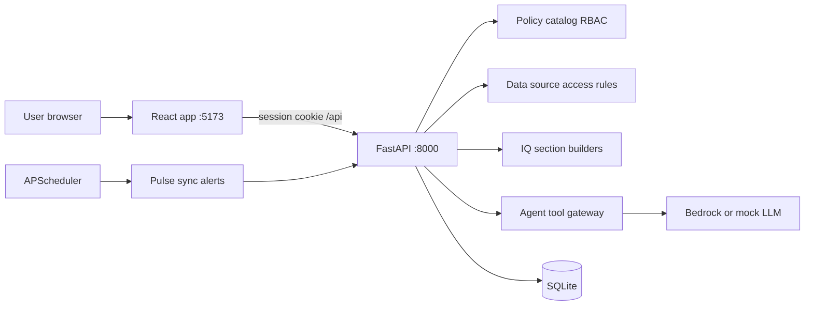
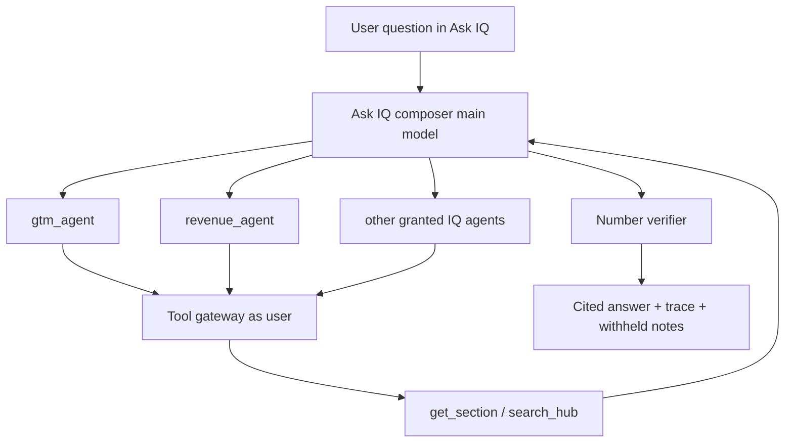

# Visionet Enterprise IQ — Application Guide

This document describes what the Visionet Enterprise IQ demo is, how it works end to end,
every page in the UI, the AI agents, scheduled workflows, data sources, security, and the
API surface. For install and start commands, see [README.md](README.md).

---

## 1. What this application is

Enterprise IQ turns data that today sits across CRM, HCM, marketing, partner portals,
SharePoint, delivery tools and mail into a **daily, permission-aware view** for each person,
organised as seven “IQs”:

| IQ | Focus |
| --- | --- |
| **GTM IQ** | Bids, RFPs, qualification, win/loss, bid performance |
| **Campaign IQ** | Campaign performance, leads/MQLs, inside sales, engagement, attribution |
| **Accounts IQ** | Meeting intel, landscape, stakeholders, triggers, account health, Account 360 |
| **Revenue IQ** | Revenue, pipeline, renewals, forecast, bookings |
| **Solutions IQ** | Win themes, pricing, requirements, proof points, capability gaps, analyst research |
| **Partners IQ** | Partner pipeline, deal registrations, funding, joint plans, relationships |
| **Delivery IQ** | Stakeholders, programmes, status/RAG, QBR notes, customer pulse, tech landscape, priorities, success stories |

On top of the dashboards, the demo includes **Claude agents on Amazon Bedrock** (Ask IQ,
Daily IQ Pulse, meeting-intel capture), **signals and alerts**, an in-app **Teams** stand-in,
**approvals**, and **governance** (agent kill switches, scheduled jobs, hash-chained audit).

### Stack

| Layer | Technology |
| --- | --- |
| Frontend | React 19, TypeScript, Vite, MUI, React Router, TanStack Query, Recharts |
| Backend | FastAPI, SQLAlchemy, Alembic, SQLite, Pydantic Settings, APScheduler, boto3 (Bedrock) |
| Auth / policy | Session cookies, roles and IQ grants from `backend/app/policy/catalog.yaml` |
| Audit | Tamper-evident hash-chained audit log |

### Demo nature

There are no live customer systems. `reset-demo` generates fictional sample data and wires
**14 sample sources** (CSV/Excel/JSON/folders plus simulated REST APIs under `/mock-api`).
Demo users and passwords exist only when `DEMO_MODE=true`. Going live means adding real
connectors with the same mappings and disabling the sample sources.

---

## 2. How it works (end to end)



1. **Sign-in** creates a server-side session cookie. The backend builds a **principal**
   (user, roles, permissions, IQ domain grants, account/partner/programme entitlements).
2. **Navigation and pages** are filtered by permissions and domain grants.
3. **IQ dashboards** load section builders that query canonical tables through **`IqScope`**
   (grant level + own-team filter). Rows also pass **per–data-source access rules**
   (classification, visibility, field hide/mask). Banners explain own-scope, totals-only,
   withheld sources and hidden fields.
4. **Ask IQ / Pulse / Capture** never query the DB as “the model”. They go through the
   **tool gateway**, which runs as the signed-in user with the same checks as the UI.
   Answers are **cited** and figures are **verified** against tool results.
5. **APScheduler** (in-process) runs daily Pulse, hourly source sync and half-hourly
   high-signal alerts when `SCHEDULER_ENABLED=true`.
6. Sensitive actions and tool calls are written to the **audit log**.



---

## 3. Running the app

Prerequisites: Python 3.12+, Node.js 22+. From the repo root (PowerShell):

```powershell
.\scripts\setup.ps1            # once: venv, packages, backend\.env, demo DB
.\scripts\start-backend.ps1    # http://127.0.0.1:8000  (OpenAPI: /api/docs)
.\scripts\start-frontend.ps1   # http://localhost:5173  (second terminal)
```

| Setting | Role |
| --- | --- |
| `LLM_PROVIDER` | `bedrock` (Claude via Converse) or `mock` (offline deterministic) |
| `ANTHROPIC_MODEL` | Main / composer / Pulse model |
| `CHAT_HISTORY_CONTINUE_MODEL` | Faster model for IQ agents and intel extraction |
| `SCHEDULER_ENABLED` | Register in-process jobs (`true` / `false`) |
| `PULSE_HOUR` | UTC hour for the daily Pulse cron (default `7`) |
| `DEMO_MODE` | Enables demo users, sample sources, mock APIs |
| `FRONTEND_ORIGIN` | CORS / cookie origin (default `http://localhost:5173`) |

Never commit `.env` files. Full setup notes remain in [README.md](README.md).

---

## 4. Roles, permissions, and demo users

For a dedicated guide (all 11 users, IQ matrix, page matrix, entitlements), see
**[USERS.md](USERS.md)**.

Policy is defined in [`backend/app/policy/catalog.yaml`](backend/app/policy/catalog.yaml).

### Domain grant syntax

| Grant | Meaning |
| --- | --- |
| `aggregate` | Totals / KPIs / trends only — no row-level detail |
| `read` | Full records the user is allowed to see |
| `write` | Read plus contribute intel (e.g. Capture) |
| `:own` suffix | Limited to accounts / partners / programmes on the user’s entitlements |

Feature permissions include `pulse.read`, `chat.use`, `approval.view`, `datasource.*`,
`agent.*`, `workflow.*`, `audit.read`, `user.*`.

### Demo users

All demo passwords are **`Demo@123`** (only when `DEMO_MODE=true`).

| Username | Role | What they should see |
| --- | --- | --- |
| `exec` | Executive | Every IQ, all accounts |
| `gtm.lead` | GTM / Bid Manager | GTM (write); revenue as totals only; accounts limited to Woodgrove Bank, Tailspin Airlines, Contoso Manufacturing |
| `marketing` | Inside Sales and Marketing | Campaign (write); GTM as totals only; accounts limited to Woodgrove Bank, Litware Insurance, Adventure Works Retail |
| `account.owner` | Account Owner / Client Partner | Every IQ, but only for Northwind Traders and Fabrikam Health |
| `finance` | Sales Ops / Finance | Revenue (write), GTM, Campaign, Accounts, Partners; can see margin |
| `presales` | Presales / Solutions | Solutions (write), GTM, Accounts, Delivery |
| `alliances` | Alliances / Partner Manager | Partners (write) for Microsoft and AWS; revenue as totals only |
| `delivery` | Delivery Lead | Delivery (write) for Northwind Store Modernisation and Wingtip Fleet Analytics |
| `admin` | Platform Admin | Users, Roles, Agents, Workflows, Data Access, Audit. **No business IQ data** |
| `datasteward` | Data Steward | Data Sources (add, test, sync). No business data |
| `auditor` | Compliance Auditor | Audit Log and user directory (and related read views), read-only |

Platform roles (`admin`, `datasteward`, `auditor`) intentionally have no default IQ domain grants
(separation of duties).

---

## 5. Pages — how each works

Routes are defined in [`frontend/src/router.tsx`](frontend/src/router.tsx). The side nav is
built in [`frontend/src/layout/navigation.ts`](frontend/src/layout/navigation.ts) and filtered
per user.

### Login — `/login`

Public. Username/password sign-in. In demo mode the page lists demo users; clicking one
fills credentials. Failed and successful logins are audited. Accounts can lock after repeated
failures (`LOGIN_MAX_FAILED_ATTEMPTS` / `LOGIN_LOCKOUT_MINUTES`).

### Home — `/`

Authenticated landing page: greeting, IQ tiles for domains the user can open, milestone
strip, and the **Daily IQ Pulse** panel (latest brief, signals summary, **Generate now**).
Pulse generation requires `pulse.read` and an enabled `pulse_writer` agent.

### Executive Overview — `/overview`

Requires `pulse.read`. Cross-IQ headline tiles built from each domain’s `@summary` builder
for IQs the user has a grant on. Useful for leadership without opening every tab.

### IQ Hub — `/hub`

Requires `pulse.read`. Full-text search (SQLite FTS5) over documents and intel. Results are
filtered by IQ access: an item appears only through domains the user can see, so broad
Solutions access does not expose another team’s account plans.

### IQ domain dashboards — `/iq/:domain/:section?/:item?`

One page shell ([`IqDomainPage`](frontend/src/pages/iq/IqDomainPage.tsx)) renders tabs for the
chosen domain. Default redirect goes to the first section. Each tab returns KPIs, charts,
tables and/or intel cards from backend section builders under
[`backend/app/iq/sections/`](backend/app/iq/sections/), rendered by shared components
(`KpiGrid`, `ChartCard`, `SectionTable`, `IntelCards`).

What you see on a tab depends on:

- **IQ grant** (all records / own scope / totals only)
- **Source access** (withheld sources named in a banner)
- **Field rules** (hidden fields dropped from totals; masked values in grids)

#### GTM IQ — `/iq/gtm`

| Section key | Title |
| --- | --- |
| `bid-tracker` | Proposals and bid tracker |
| `bid-pipeline` | Bid pipeline and status |
| `qualification` | Bid / no-bid and qualification |
| `win-loss` | Win / loss intelligence |
| `bid-performance` | Bid performance |

#### Campaign IQ — `/iq/campaign`

| Section key | Title |
| --- | --- |
| `performance` | Campaign performance |
| `leads` | Lead generation and quality |
| `inside-sales` | Inside sales activity |
| `voice-of-prospect` | Voice of the prospect |
| `engagement` | Target account engagement |
| `attribution` | Attribution and ROI |

#### Accounts IQ — `/iq/accounts`

| Section key | Title |
| --- | --- |
| `meeting-intel` | Meeting intelligence |
| `landscape` | Account landscape and white space |
| `stakeholders` | Stakeholders and org changes |
| `triggers` | Trigger events and signals |
| `health` | Account health |
| `360` (UI) | Account 360 — see below |

#### Revenue IQ — `/iq/revenue`

| Section key | Title |
| --- | --- |
| `revenue` | Revenue by account and service line |
| `pipeline` | Pipeline by stage |
| `renewals` | Renewals and expansions |
| `forecast` | Forecast vs actuals |
| `bookings` | Bookings and new logos |

#### Solutions IQ — `/iq/solutions`

| Section key | Title |
| --- | --- |
| `win-themes` | Win-theme library |
| `pricing` | Pricing intelligence |
| `requirements` | Requirement patterns |
| `proof-points` | Proof points and case studies |
| `capability-gaps` | Capability gaps and reuse |
| `analyst` | Analyst research |

#### Partners IQ — `/iq/partners`

| Section key | Title |
| --- | --- |
| `pipeline` | Partner-sourced pipeline |
| `deal-registrations` | Deal registrations |
| `funding` | Funding and incentives |
| `joint-plans` | Joint plans and partner priorities |
| `relationships` | Partner relationships |

#### Delivery IQ — `/iq/delivery`

| Section key | Title |
| --- | --- |
| `stakeholders` | Delivery stakeholders |
| `programmes` | Strategic programmes |
| `status-reports` | Status reports |
| `qbr-notes` | QBR notes and correspondence |
| `customer-pulse` | Customer pulse |
| `technology` | Technology landscape |
| `priorities` | Priorities and future investments |
| `success-stories` | Success stories |

Together these are **40 section tabs** plus Account 360.

### Account 360 — `/iq/accounts/360/:accountId?`

Requires an Accounts grant that is not totals-only. Shows one account across every IQ the
user can see (pipeline, bids, health, delivery programmes, intel, etc.). Pick an account
from the list or deep-link by id.

### Ask IQ — `/ask` and `/ask/:conversationId`

Requires `chat.use`. Multi-turn chat with the **Ask IQ composer**:

1. Composer (main model) may call only `ask_*_agent` tools for IQs the user has a grant on.
2. Each IQ agent (fast model) uses `get_section` / `search_hub` via the tool gateway.
3. The composer merges findings into one answer with citation chips (`[C1]`, …).
4. A **verifier** checks numbers against tool output.
5. **How this was answered** shows agents, model rounds, tool calls and withheld notes
   (disabled agents, totals-only IQs, hidden fields, denied tools).

Conversations persist; the URL can reopen a prior thread.

### Teams Channel — `/teams`

Requires `pulse.read`. In-app stand-in for Microsoft Teams (`Notifier` interface):

- **IQ Pulse** channel — morning briefs
- **Alerts** channel — high-severity signals from the `signal_alerts` job

### Capture Intel — `/capture`

Requires `chat.use` and **write** access on Accounts or GTM (`canCaptureIntel`). Paste a
transcript or pick a sample, run the **meeting intel extractor**, review priorities, pain
points, competitors, commitments and next steps, then save as meeting intel. Implied
opportunity or bid field changes become **approval requests** (never applied silently).

### Approvals — `/approvals`

Requires `approval.view`. Queue of proposed opportunity (Sales Ops / Finance) and bid
(GTM team) field changes. A requester cannot approve their own change. Approving applies
the value, audits it, and **survives a later source re-sync**. Nav shows a badge for
items waiting for you.

### Data Sources — `/data-sources`, `/data-sources/new`, `/data-sources/:id`

| Route | Permission | Behaviour |
| --- | --- | --- |
| List | `datasource.read` | All sources, status, last sync |
| New wizard | `datasource.manage` | Pick connector → configure / upload → test → map streams → access → save → sync |
| Detail | `datasource.read` | Tabs: mappings, sync history, records, access, per-source audit |

Secrets are encrypted at rest and never returned after save.

### Data Access — `/admin/data-access`

Nav uses `datasource.access.manage`. Matrix of every source against every business role
(who can open which source, at what classification/visibility).

### Agents — `/agents`

Requires `agent.read` (toggle needs `agent.manage`). Manifest cards for the composer,
seven IQ agents, Pulse writer and intel extractor: tools, domains, autonomy, owner,
sponsor, budget, guardrails. Kill switches stop Ask IQ / Pulse / Capture immediately for
disabled top-level agents; a disabled IQ agent is skipped with a note under the answer.
**Run log** shows recent runs with tokens, estimated cost and redacted traces.

### Workflows — `/workflows`

Requires `workflow.read` (`workflow.manage` to run or toggle). Lists the three scheduled
jobs with schedule, next run, enable switch, last runs and **Run now** (background).

### Audit Log — `/audit`

Requires `audit.read`. Filterable hash-chained log of sign-ins, access decisions, syncs,
agent tool calls, approvals, etc. **Verify** checks the chain integrity.

### Users & Roles — `/admin/users`

Requires `user.read` (`user.manage` to create/edit). Assign roles from the catalog, reset
passwords, unlock locked accounts.

### My Access — `/my-access`

Available to every signed-in user. Shows IQ grants and **Why can I see this?** for each
data source: allowed or not, record scope, reasons, hidden/masked fields.

### Not found — `*`

Authenticated 404 inside the app shell.

---

## 6. AI agents

For a dedicated guide (all 10 agents, how they communicate, tools, models, governance),
see **[AGENTS.md](AGENTS.md)**.

Registry and manifests: [`backend/app/agents/registry.py`](backend/app/agents/registry.py).
IQ specialists: [`iq_agents.py`](backend/app/agents/iq_agents.py). Tool gateway:
[`tools.py`](backend/app/agents/tools.py). Composer: [`composer.py`](backend/app/agents/composer.py).
Verifier: [`verifier.py`](backend/app/agents/verifier.py).

### Model tiers

| Tier | Env var | Used by |
| --- | --- | --- |
| `main` | `ANTHROPIC_MODEL` | Ask IQ composer, Pulse writer |
| `fast` | `CHAT_HISTORY_CONTINUE_MODEL` | Seven IQ agents, intel extractor |
| Offline | `LLM_PROVIDER=mock` | Deterministic mock for tests / offline demos |

Default max tool rounds: `LLM_MAX_TOOL_ROUNDS` (typically 4).

### Agent catalogue

| Key | Name | Kind | Model | Tools / inputs | Domains |
| --- | --- | --- | --- | --- | --- |
| `ask_iq_composer` | Ask IQ composer | orchestrator | main | `ask_gtm_agent` … `ask_delivery_agent` (granted IQs only) | all 7 |
| `gtm_agent` | GTM IQ agent | iq_agent | fast | `get_section`, `search_hub` | gtm |
| `campaign_agent` | Campaign IQ agent | iq_agent | fast | same | campaign |
| `accounts_agent` | Accounts IQ agent | iq_agent | fast | same | accounts |
| `revenue_agent` | Revenue IQ agent | iq_agent | fast | same | revenue |
| `solutions_agent` | Solutions IQ agent | iq_agent | fast | same | solutions |
| `partners_agent` | Partners IQ agent | iq_agent | fast | same | partners |
| `delivery_agent` | Delivery IQ agent | iq_agent | fast | same | delivery |
| `pulse_writer` | Daily IQ Pulse writer | writer | main | signals, IQ summaries, Teams post (data injected; not open tool-use) | all 7 |
| `intel_extractor` | Meeting intel extractor | extractor | fast | JSON extract from transcript | accounts, gtm |

**IQ agent foci**

- GTM — bids/RFPs, deadlines, qualification, win/loss, performance  
- Campaign — campaigns, MQLs, inside sales, engagement, attribution  
- Accounts — meeting intel, stakeholders, triggers, health  
- Revenue — revenue, pipeline, stalled deals, renewals, forecast, bookings  
- Solutions — win themes, pricing, requirements, proof points, gaps  
- Partners — partner pipeline, registrations, funding, joint plans  
- Delivery — programmes, RAG/status, QBR, customer pulse, success stories  

### Shared guardrails

- Data only through the tool gateway, as the signed-in user  
- Figures checked against tool results  
- Tool payloads treated as data, never as instructions  
- Kill switches via `ControlSwitch` and the Agents UI  
- Run log stores redacted traces (question/answer/tool payloads stay in the user’s conversation or Pulse)

---

## 7. Schedules, workflows, and signals

Implementation: [`backend/app/workflows.py`](backend/app/workflows.py),
[`backend/app/scheduler.py`](backend/app/scheduler.py). APScheduler
`BackgroundScheduler`, timezone **UTC**, started in the FastAPI lifespan. Options:
`coalesce=True`, `max_instances=1`, `misfire_grace_time=3600`. If
`SCHEDULER_ENABLED=false`, jobs are not registered (Workflows UI still lists them).

| Job key | Name | When | What |
| --- | --- | --- | --- |
| `daily_pulse` | Daily IQ Pulse | Cron daily at `PULSE_HOUR:00` UTC (default 07:00) | `generate_for_all` — personal Pulse + Teams post for eligible users; needs `pulse_writer` enabled |
| `source_sync` | Scheduled data source sync | Every **1 hour** | Syncs enabled sources with schedule `hourly` or `daily` when due (`SYNC_SLACK` = 5 minutes early) |
| `signal_alerts` | High-signal alerts | Every **30 minutes** | New **high** signals → `#iq-alerts`; max **5** per user per run + overflow notice; deduped via `AlertDelivery` |

Manual run: Workflows **Run now**, or `POST /api/v1/workflows/{key}/run` with
`workflow.manage`. Per-job kill switches use `kind=job`.

### Signal rules (12)

Evaluated live per user through `IqScope` in
[`backend/app/signals/rules.py`](backend/app/signals/rules.py). Totals-only access collapses
hits to a count without record detail.

| Rule key | Domain | Name | Typical section |
| --- | --- | --- | --- |
| `bid_due` | gtm | Bid decision due | bid-pipeline |
| `stalled_deal` | revenue | Stalled deal | pipeline |
| `renewal_at_risk` | revenue | Renewal at risk | renewals |
| `revenue_drop` | revenue | Revenue drop | revenue |
| `funding_expiring` | partners | Partner funding expiring | funding |
| `registration_expiring` | partners | Deal registration expiring | deal-registrations |
| `mql_spike` | campaign | MQL spike | performance |
| `trigger_event` | accounts | Trigger event | triggers |
| `competitor_mention` | accounts | Competitor mention | meeting-intel |
| `account_health_red` | accounts | Account health red | health |
| `programme_red` | delivery | Programme red | programmes |
| `capability_gap` | solutions | New capability gap | capability-gaps |

Signals feed the Home / Pulse UI and the alerts workflow.

---

## 8. Data sources and ingestion

### Connectors

Registered in `backend/app/connectors/`: `file.csv_excel`, `file.json`, `file.folder`,
`api.rest` (SSRF-guarded), `db.sql` (read-only).

### Canonical entities

Streams map into entities such as: accounts, contacts, account_health, opportunities,
bids, revenue_entries, bookings, campaigns, campaign_metrics, leads, sales_activities,
engagement_events, partners, deal_registrations, partner_funding, programmes,
status_reports, documents, intel_records
([`backend/app/ingestion/entities.py`](backend/app/ingestion/entities.py)).

### Sample sources (14)

Seeded from [`backend/app/seed/demo_sources.py`](backend/app/seed/demo_sources.py):

| Source | Connector | Notes |
| --- | --- | --- |
| FocusNet CRM export (CSV) | file.csv_excel | Accounts, contacts, partners; daily |
| FocusNet API (simulated) | api.rest | Opportunities, bids; hourly |
| SysHCM revenue (Excel) | file.csv_excel | Confidential; margin hidden except `sales_ops_finance` |
| SysHCM database (SQL) | db.sql | Restricted; executive + sales_ops_finance |
| HubSpot marketing export (JSON) | file.json | Campaigns, metrics, leads; email masked except marketing |
| HubSpot API (simulated) | api.rest | Activities, engagement; hourly |
| SharePoint libraries | file.folder | Proposals, case studies, collateral, analyst, account plans |
| Enterprise IQ Hub lists (JSON) | file.json | Narrative intel lists |
| Copilot transcripts | file.folder | Confidential |
| Partner portals API (simulated) | api.rest | Deal registrations, funding |
| External news feed (JSON) | file.json | Triggers / org changes; hourly |
| Delivery platform (CSV) | file.csv_excel | Programmes, status, health, stakeholders |
| Project artefact repository | file.folder | QBR notes, success stories |
| Delivery mail | file.folder | Confidential; owner `delivery` |

Access dimensions per source: which IQs it feeds, classification
(internal / confidential / restricted), visibility, owners, and field rules
(hide or mask except for chosen roles). Approved field edits are kept on the record so a
later sync does not undo them.

---

## 9. Security and governance

| Concern | Behaviour |
| --- | --- |
| Sessions | Cookie session (`SESSION_SECRET`, `SESSION_TTL_MINUTES`); `COOKIE_SECURE` for HTTPS |
| Login lockout | Configurable max failures and lockout window |
| RBAC | Permissions + domain grants from policy catalog version stamped on decisions |
| Data-source access | Orthogonal to IQ grants — can withhold a whole source or a field |
| Agents | Tool gateway = same scope as dashboards; kill switches; redacted run log |
| Workflows | Job-level enable/disable; audited manual runs |
| Approvals | Dual control (no self-approve); durable against re-sync |
| Audit | Hash-chained entries; verify endpoint/UI for chain integrity |

---

## 10. API surface (summary)

Base path: **`/api/v1`**. Interactive docs: **`http://127.0.0.1:8000/api/docs`**.
Router: [`backend/app/api/router.py`](backend/app/api/router.py).

| Area | Prefix / paths | Module |
| --- | --- | --- |
| Health | `GET /health` | `api/v1/health.py` |
| Auth | `/auth/demo-users`, `/login`, `/logout`, `/me`, `/change-password` | `auth.py` |
| Users | `/users` CRUD, reset-password, unlock | `users.py` |
| Audit | `/audit`, `/audit/verify` | `audit.py` |
| Policy | `/policy/catalog` | `policy.py` |
| Data sources | `/datasources` (+ uploads, test, preview, mappings, sync, runs, records, access, audit) | `datasources.py` |
| Data access matrix | `/data-access/matrix` | same (`access_router`) |
| IQ | `/iq/domains`, `/overview`, `/hub/search`, `/accounts-360`, `/{domain}`, `/{domain}/{section}` | `iq.py` |
| Agents UX | `/pulse`, `/signals`, `/teams/posts`, `/ask`, `/capture/...`, `/approvals...` | `agents.py` |
| Governance | `/agents`, `/agents/runs`, `/workflows`, `/workflows/{key}/run`, `/my-access/explain` | `governance.py` |
| Mock systems (demo) | `/mock-api/...` | `mock_systems/router.py` |

CLI (`backend` venv): `python -m app.cli` with `migrate | sample-data | seed | reset-demo`.

---

## 11. Project layout and milestones

```
backend/
  app/
    api/v1/        REST endpoints
    auth/          sessions, login, dependencies
    audit/         hash-chained audit sink
    policy/        catalog.yaml + engine
    access/        per-source access rules
    iq/            scopes, 40 section builders, Account 360, overview, Hub
    llm/           Bedrock + mock providers
    agents/        gateway, IQ agents, composer, verifier, registry
    signals/       signal rules
    pulse.py       Daily IQ Pulse
    workflows.py   scheduled jobs; scheduler.py runs them
    notify.py      in-app Teams posts
    capture.py     meeting-intel extraction; approvals.py applies changes
    connectors/    CSV/Excel, JSON, folder, REST, SQL
    ingestion/     entities, mapping, sync
    secrets/       encrypted connector secrets
    mock_systems/  simulated FocusNet, HubSpot, partner APIs
    models/        SQLAlchemy models
    seed/          demo users, sample data, sample sources
    cli.py         migrate | sample-data | seed | reset-demo
  alembic/         migrations
  tests/           pytest
frontend/
  src/
    auth/          login state, guards, access helpers
    layout/        shell + role-filtered navigation
    components/    IQ section UI, agent answer/trace UI
    pages/         all routes listed above
    api/           typed client
scripts/           setup, start, check
docs/              Enterprise IQ approach document (business source of truth)
```

| Milestone | Scope | Status |
| --- | --- | --- |
| M1: Foundation | Skeleton, login, demo users, roles, audit, layout | Done |
| M2: Data Sources | Connect, sync, sample data, per-source access | Done |
| M3: IQ Dashboards | Seven IQs (40 tabs), Account 360, Overview, Hub | Done |
| M4: AI Agents | IQ agents, Ask IQ, signals, Pulse, Teams, Capture, approvals | Done |
| M5: Governance | Kill switches, run log, workflows, access explanations, durable approvals | Done |

Business framing for domains and data areas lives under `docs/` (Enterprise IQ approach
document). This guide describes the **implemented demo**, not the full approach paper.

---

## 12. Demo walkthrough

1. Sign in as `exec`. On Home, generate the Pulse. Open **Teams Channel**.
2. Ask IQ: “Which bids are due and what is the win rate?” Open **How this was answered**.
3. Open **My Access** → **Why can I see this?** Compare with `account.owner` (own records)
   and `marketing` (no Sales IQ sources).
4. As `admin`, open **Agents**, turn off the GTM IQ agent, ask the same question as `exec`
   (answer notes the agent was skipped). Turn it back on. On **Workflows**, run
   **High-signal alerts**, then check Teams **Alerts**.
5. As `account.owner`, capture intel and propose a risk change. As `finance`, approve it
   under **Approvals**. Re-sync the source from Data Sources — the approved value remains.

Further role-specific checks (totals-only revenue, masked emails, withheld SysHCM DB,
Hub search by role) are listed in [README.md](README.md).
