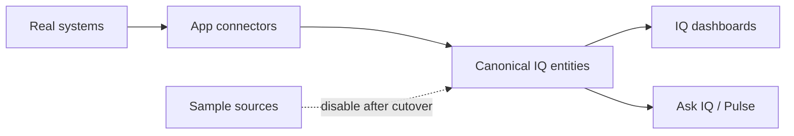

# Enterprise IQ — Live Data Integrations (Manager Discussion Pack)

Use this document with your manager or client to move from **dummy/sample data** to **real
systems**. It is based on the Enterprise IQ approach document and on what this application
can already connect to.

Related docs: [CLIENT_BRIEF.md](CLIENT_BRIEF.md) (how to explain IQs),
[APPLICATION.md](APPLICATION.md) (product), [USERS.md](USERS.md) (who can add sources).

Approach source:
[`docs/Enterprise_IQ_Daily_Intelligence_Approach (1).docx`](docs/Enterprise_IQ_Daily_Intelligence_Approach%20(1).docx).

---

## 1. Reality check (say this first)

Today the demo uses **14 sample sources** and simulated APIs under `/mock-api`. There is
already a **Data Sources** wizard (`datasteward` user). Going live means:

1. Add the **real** system as a new source (same field mappings as the sample).
2. Test, sync, set access (classification, who can see it).
3. **Disable** the sample source.

**“Real-time” in this app today** means a **scheduled pull** (hourly / daily / manual), not
streaming change-data-capture. A fair sentence for leadership:

> We can get near–real-time (for example hourly API pulls) for CRM and marketing, and daily
> for finance extracts and document libraries. True push/streaming would be a later phase.

---

## 2. What the approach document says you need

| System | Role | Feeds IQ(s) |
| --- | --- | --- |
| **FocusNet (CRM)** | System of record for accounts, contacts, opportunities, proposals. Every intel record should carry FocusNet Account ID / Opportunity ID | GTM, Campaign, Accounts, Revenue (pipeline), Solutions, Partners |
| **SysHCM** | Revenue actuals, service mix, renewals, forecast vs actuals (often via extracts) | Revenue, Campaign, Partners |
| **HubSpot** | Campaigns, leads, engagement, inside sales | Campaign |
| **SharePoint** | Proposals library, account plans, analyst/collateral, Enterprise IQ Hub lists | GTM, Accounts, Solutions, Partners |
| **Teams + Copilot** | Meeting / bid-debrief transcripts; channel for Daily Pulse | Accounts, GTM; Pulse out |
| **Power Automate** | Moves extracts; triggers alerts and daily Pulse (document vision) | Cross-cutting |
| **Power BI** | Combined revenue + pipeline + intel coverage view | Revenue (listed as a source) |
| **Microsoft Partner Center / AWS Partner Central** | Deal registrations, funding | Partners |
| **External feeds** | News / LinkedIn-style triggers, org changes, competitor moves | Accounts |
| **Delivery platform (TBD)** + artefact repo + mail | Programmes, weekly status, QBR, pulse | Delivery |

The Word document does **not** specify APIs, SSO, security, or a phased order. Those are the
decisions you need from your manager (section 6).

---

## 3. What this application can connect to today (no new code)

| Connector | Use for live data | Limits |
| --- | --- | --- |
| `api.rest` | JSON GET APIs (FocusNet, HubSpot, partner APIs if they expose REST) | Auth: API key / bearer / basic; **host allowlist**; GET only |
| `file.csv_excel` / `file.json` | Nightly or monthly **exports** dropped to a folder or uploaded | Files must live under allowed paths |
| `file.folder` | Document / transcript / mail **exports** (md, docx, pdf, eml, …) | Not live SharePoint Online |
| `db.sql` | Read-only SQL (SysHCM warehouse / replica) | SELECT only (Postgres, SQL Server, MySQL, SQLite) |
| `capture` | Human-reviewed meeting intel from Capture Intel | Not an external pull |

**Cutover pattern:** Data Steward adds real source → map streams to canonical entities →
test → sync → set access → disable sample.

Canonical entities include: accounts, contacts, opportunities, bids, revenue_entries,
bookings, campaigns, leads, programmes, documents, intel_records, and related tables.

UI: sign in as **`datasteward`** / `Demo@123` → **Data Sources**.

---

## 4. Connection plan — system by system

### Phase 1 — Commercial core (highest impact)

**1. FocusNet (CRM)**

- **Need:** UAT or production API base URL, **or** nightly CSV/JSON export of accounts,
  contacts, opportunities, bids/proposals.
- **How:** Prefer `api.rest` (hourly) for opportunities/bids; `file.csv_excel` (daily) for
  master data if the API is weak. Map to `accounts`, `contacts`, `opportunities`, `bids`,
  `partners`.
- **Ask for:** API docs, sandbox credentials, system-of-record fields, Account ID format,
  rate limits, network allowlist for the Enterprise IQ host.

**2. SysHCM (revenue)**

- **Need:** Monthly/weekly revenue extract (Excel/CSV) and/or a **read-only** DB view for
  bookings.
- **How:** `file.csv_excel` → `revenue_entries`; `db.sql` → `bookings`. Keep
  confidential/restricted classification and margin field rules.
- **Ask for:** Extract owner, schedule, replica connection (not production write), who may
  see margin and PII.

**3. HubSpot**

- **Need:** Private app token or OAuth app; scopes for campaigns, leads, engagements.
- **How:** `api.rest` against HubSpot CRM APIs, or a daily JSON export. Keep the
  **FocusNet campaign code** on campaigns so attribution still joins.
- **Ask for:** Marketing admin to create the app, scopes, sandbox portal, data-quality owner.

### Phase 2 — Documents and meeting intel

**4. SharePoint**

- **Need a decision:**
  - **A)** Microsoft Graph connector (new engineering), or
  - **B)** Power Automate / script nightly copy of libraries into a folder that
    Enterprise IQ reads with `file.folder` (works with current code).
- **Libraries:** proposals, account plans, collateral, analyst, Hub intel lists.
- **Ask for:** Site URLs, library names, Graph app + `Sites.Read`, **or** approval of an
  export pipeline.

**5. Teams / Copilot transcripts**

- **Need:** Graph permissions for transcripts, **or** keep **Capture Intel** (paste/select)
  as the interim path.
- **Ask for:** Legal/compliance OK to store transcripts; Graph scopes; whether Pulse should
  post to **real** Teams (today: in-app channel).

### Phase 3 — Partners, delivery, enrichment

**6. Partner portals (Microsoft Partner Center, AWS Partner Central)**

- **Need:** API credentials or an export of deal registrations and funding.
- **How:** `api.rest` if JSON GET exists; else scheduled CSV → `deal_registrations`,
  `partner_funding`.
- **Ask for:** Alliances owner; API vs export; how partner IDs map to FocusNet.

**7. Delivery platform (still TBD in the approach document)**

- **Need:** The **real system name** (ServiceNow, Azure DevOps, Clarity, etc.) plus API or
  weekly CSV for programmes, status/RAG, stakeholders, health.
- **How:** Map to `programmes`, `status_reports`, `account_health`, `contacts`,
  `intel_records`.
- **Ask for:** Delivery leadership to name the system of record and a sample export.

**8. External news / triggers**

- **Need:** Vendor news API or a curated JSON feed from research ops.
- **How:** Hourly `file.json` or `api.rest` → `intel_records` (trigger / org change /
  competitor).
- **Ask for:** Budget for a news API vs an internal research feed.

**9. Power BI**

- In the approach document, Power BI is often a **dashboard** on SysHCM + FocusNet. Prefer
  ingesting those **underlying** systems (Phase 1) instead of scraping Power BI.
- **Ask:** Is Power BI the system of record, or only a report? If only a report, skip a
  direct BI connector.

**10. Power Automate / Entra ID (platform)**

- Approach document: Automate moves extracts and drives Pulse. App today: in-process
  scheduler + cookie login.
- **Ask:** Keep Automate for **file drops** into a share that Enterprise IQ syncs, versus
  rewriting flows in the app; Entra ID SSO and which groups map to which IQ roles.

---

## 5. Suggested phases with your manager

| Phase | Goal | Systems | Outcome |
| --- | --- | --- | --- |
| **P0 — Decide** | Live demo vs production | — | UAT tenant, success metrics, named owners |
| **P1 — Structured data** | Replace CRM / revenue / marketing samples | FocusNet, SysHCM, HubSpot | Dashboards + Ask IQ on real commercial data |
| **P2 — Documents / meetings** | Proposals + transcripts | SharePoint path A or B, Teams/Capture | Hub search + Capture quality |
| **P3 — Channel + delivery** | Partners + delivery SoR | Partner portals, named delivery platform, mail/artefacts | Partners + Delivery IQ live |
| **P4 — Hardening** | Production | Entra SSO, Postgres, secrets vault, allowlists, disable samples, audit | Production cutover |

---

## 6. Checklist to ask your manager (copy this)

1. **Priority:** Which IQ must go live first (Revenue / GTM / Campaign / Accounts)?
2. **Environment:** UAT with masked data, or production?
3. **FocusNet:** API or only exports? Who owns CRM? Sandbox credentials?
4. **SysHCM:** Excel extract schedule and path, or read-only database? Who approves finance access?
5. **HubSpot:** Can Marketing create a private app / token for Enterprise IQ?
6. **SharePoint:** Graph app registration, or nightly export via Power Automate? Which sites/libraries?
7. **Teams/Copilot:** Allowed to store transcripts in Enterprise IQ? Real Teams posting for Pulse?
8. **Delivery platform:** What is the real system name (still TBD in the approach document)?
9. **Partner portals:** API access for Microsoft/AWS deal registration and funding?
10. **Network/security:** Can the Enterprise IQ host call these APIs (firewall / allowlist)? Where do secrets live?
11. **Identity:** Entra ID SSO, and which AD groups map to which Enterprise IQ roles?
12. **Ownership:** Named data steward + system owner per source for mapping/sync failures?
13. **Cadence:** Hourly for CRM/HubSpot APIs, daily for finance/docs — acceptable as “near real-time”?
14. **Budget / engineering:** Approve Graph (SharePoint/Teams) work if an export path is not enough?
15. **Compliance:** Do classification rules still apply on real data (margin hidden, restricted bookings, masked emails)?

---

## 7. What not to promise yet

- Instant, sub-second “real-time” streaming (not in the current architecture)
- Native SharePoint / Teams / Power BI connectors (not built; need Graph or an export workaround)
- Complete Delivery IQ until the **delivery platform is named**
- AI answers better than the source data — Account ID linkage and mapping quality are mandatory

---

## 8. After they agree (engineering, not this meeting)

Configure real sources as `datasteward` in Data Sources; whitelist API hosts; store secrets;
map fields; sync; disable samples. Phase 1 needs **no new connector code** if APIs or
exports exist. Graph connectors for SharePoint/Teams are a separate story after P0/P1.
