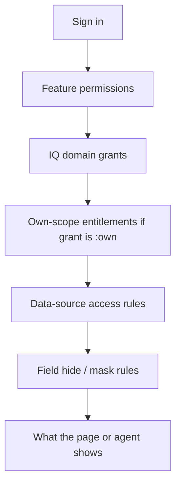

# Visionet Enterprise IQ — Users and Access Guide

This document lists every demo user, their role, feature permissions, IQ grants, and
scoped entitlements (accounts / partners / programmes).

Related docs: [APPLICATION.md](APPLICATION.md), [AGENTS.md](AGENTS.md), [README.md](README.md).

Policy source: [`backend/app/policy/catalog.yaml`](backend/app/policy/catalog.yaml).  
User seed: [`backend/app/seed/demo_users.py`](backend/app/seed/demo_users.py).

---

## 1. Quick facts

| Item | Value |
| --- | --- |
| Number of demo users | **11** |
| Shared password | **`Demo@123`** |
| Available when | `DEMO_MODE=true` only |
| Email pattern | `{username}@demo.example.com` |
| Where to sign in | http://localhost:5173/login (users are listed on the login page) |

There are two kinds of roles:

- **Platform roles** — run the product (users, sources, agents, audit). **No business IQ data**
  by default (separation of duties).
- **Business roles** — see IQ dashboards, Ask IQ, Pulse, Capture (where grants allow).

---

## 2. How access works

Access is layered. A user only sees a record if **all** applicable layers allow it.



### Feature permissions (RBAC)

Control which **pages and actions** appear (Ask IQ, Data Sources, Agents, Audit, etc.).

| Permission | What it allows |
| --- | --- |
| `pulse.read` | Daily IQ Pulse, Executive Overview, Hub, Teams |
| `chat.use` | Ask IQ (and Capture when combined with write on Accounts/GTM) |
| `approval.view` | Approvals queue |
| `datasource.read` | View data sources |
| `datasource.manage` | Add, edit, test, sync sources |
| `datasource.access.manage` | Edit who can see each source (Data Access matrix) |
| `agent.read` / `agent.manage` | View agents / kill-switch them |
| `workflow.read` / `workflow.manage` | View / run scheduled jobs |
| `audit.read` | Audit log + chain verify |
| `user.read` / `user.manage` | View / manage users and roles |

### IQ domain grants

Syntax: `<level>` or `<level>:own`

| Level | Meaning |
| --- | --- |
| `aggregate` | Totals / KPIs / trends only — no row-level detail |
| `read` | Full records the user is allowed to see |
| `write` | Read plus contribute (e.g. Capture meeting intel) |
| `:own` | Limited to accounts / partners / programmes on the user’s **entitlements** |

Without `:own`, the grant covers all records in the tenant (still subject to source rules).

### Entitlements (“own” scope)

Stored per user (`user_entitlements`). Used when a grant is `*:own`.

| Type | Examples |
| --- | --- |
| `account` | `ACC-1001` Northwind Traders |
| `partner` | `PRT-01` Microsoft |
| `programme` | `PRG-2001` Northwind Store Modernisation |

### Data-source rules (on top of IQ grants)

Even with a domain grant, a source may:

- Be **withheld** (restricted visibility / role list)
- **Hide** a field (e.g. margin except for Finance)
- **Mask** a field (e.g. lead email except for Marketing)

See **My Access → Why can I see this?** in the app for the live explanation per user.

---

## 3. All demo users (summary)

| Username | Display name | Role key | Category | Own-scope entitlements |
| --- | --- | --- | --- | --- |
| `admin` | Platform Admin | `platform_admin` | platform | — |
| `datasteward` | Data Steward | `data_steward` | platform | — |
| `auditor` | Compliance Auditor | `auditor` | platform | — |
| `exec` | Executive | `executive` | business | — (all accounts) |
| `gtm.lead` | GTM Lead | `gtm_team` | business | Woodgrove Bank, Tailspin Airlines, Contoso Manufacturing |
| `marketing` | Marketing Manager | `marketing` | business | Woodgrove Bank, Litware Insurance, Adventure Works Retail |
| `account.owner` | Account Owner | `account_owner` | business | Northwind Traders, Fabrikam Health |
| `finance` | Finance Analyst | `sales_ops_finance` | business | — (all in granted IQs) |
| `presales` | Solutions Architect | `presales` | business | — |
| `alliances` | Partner Manager | `alliances` | business | Microsoft, AWS |
| `delivery` | Delivery Lead | `delivery_lead` | business | Programmes PRG-2001/2002; accounts Northwind, Wingtip |

Password for every user above: **`Demo@123`**.

---

## 4. Platform users (detail)

### `admin` — Platform Admin

| | |
| --- | --- |
| Title | Platform Administrator |
| Role | `platform_admin` |
| IQ domains | **None** |
| Permissions | `user.read`, `user.manage`, `agent.read`, `agent.manage`, `workflow.read`, `workflow.manage`, `datasource.read`, `datasource.access.manage`, `audit.read` |

**Can use:** Users & Roles, Agents (kill switches), Workflows (run now), Data Access matrix, Audit Log, view Data Sources list.  
**Cannot use:** Home IQ tiles with data, Ask IQ, Pulse, Capture, Revenue/GTM dashboards, etc.

### `datasteward` — Data Steward

| | |
| --- | --- |
| Title | Data Steward |
| Role | `data_steward` |
| IQ domains | **None** |
| Permissions | `datasource.read`, `datasource.manage`, `workflow.read` |

**Can use:** Data Sources wizard (add, test, map, sync), view workflows.  
**Cannot use:** Business IQ pages, Ask IQ, Agents admin, Users, Audit.

### `auditor` — Compliance Auditor

| | |
| --- | --- |
| Title | Compliance Auditor |
| Role | `auditor` |
| IQ domains | **None** |
| Permissions | `audit.read`, `user.read`, `datasource.read`, `agent.read`, `workflow.read` |

**Can use:** Audit Log (verify hash chain), user directory (read), view agents/workflows/sources.  
**Cannot use:** Manage users/agents, sync sources, or open business IQ data.

---

## 5. Business users (detail)

### `exec` — Executive (Chief Revenue Officer)

| | |
| --- | --- |
| Role | `executive` |
| Permissions | `pulse.read`, `chat.use`, `approval.view`, `datasource.read` |
| Entitlements | None (tenant-wide within grants) |

| IQ | Grant |
| --- | --- |
| GTM, Campaign, Accounts, Revenue, Solutions, Partners, Delivery | `read` each |

**Typical view:** Full leadership picture across all accounts. Sees Pulse, Overview, Hub, Ask IQ, Teams, Approvals (as assignee where applicable), Data Sources (view).  
**Notable limits:** Margin on revenue is **hidden** from executive (field rule — only Finance sees it). Restricted SysHCM database is open to executive + finance.

### `gtm.lead` — GTM / Bid Manager

| | |
| --- | --- |
| Role | `gtm_team` |
| Permissions | `pulse.read`, `chat.use`, `approval.view`, `datasource.read` |
| Own accounts | ACC-1003 Woodgrove Bank, ACC-1004 Tailspin Airlines, ACC-1006 Contoso Manufacturing |

| IQ | Grant |
| --- | --- |
| GTM | `write` |
| Campaign | `read` |
| Accounts | `read:own` |
| Revenue | `aggregate` |
| Solutions | `read` |
| Partners | `read:own` |
| Delivery | — |

**Typical view:** Full bid/proposal workspace; Capture allowed (GTM write). Revenue shows **totals only**. Accounts/partners limited to pursuit accounts (and related own partners where applicable). Can approve **bid** changes.

### `marketing` — Inside Sales & Marketing Lead

| | |
| --- | --- |
| Role | `marketing` |
| Permissions | `pulse.read`, `chat.use`, `approval.view`, `datasource.read` |
| Own accounts | ACC-1003 Woodgrove Bank, ACC-1005 Litware Insurance, ACC-1007 Adventure Works Retail |

| IQ | Grant |
| --- | --- |
| GTM | `aggregate` |
| Campaign | `write` |
| Accounts | `read:own` |
| Solutions | `read` |
| Revenue, Partners, Delivery | — |

**Typical view:** Campaign IQ owner; sees **unmasked lead emails** (field rule). GTM is totals-only. No Revenue / Partners / Delivery IQ. Capture not available (no Accounts/GTM write — Campaign write alone does not enable Capture).

### `account.owner` — Client Partner

| | |
| --- | --- |
| Role | `account_owner` |
| Permissions | `pulse.read`, `chat.use`, `approval.view`, `datasource.read` |
| Own accounts | ACC-1001 Northwind Traders, ACC-1002 Fabrikam Health |

| IQ | Grant |
| --- | --- |
| GTM | `read:own` |
| Campaign | `read:own` |
| Accounts | `write:own` |
| Revenue | `read:own` |
| Solutions | `read` |
| Partners | `read:own` |
| Delivery | `read:own` |

**Typical view:** Deep 360 for Northwind and Fabrikam only. Can **Capture** intel for those accounts. Restricted SysHCM bookings source is **withheld**. Ask IQ answers are scoped to owned accounts.

### `finance` — Sales Ops / Finance

| | |
| --- | --- |
| Role | `sales_ops_finance` |
| Permissions | `pulse.read`, `chat.use`, `approval.view`, `datasource.read` |
| Entitlements | None (tenant-wide in granted IQs) |

| IQ | Grant |
| --- | --- |
| GTM | `read` |
| Campaign | `read` |
| Accounts | `read` |
| Revenue | `write` |
| Partners | `read` |
| Solutions, Delivery | — |

**Typical view:** Revenue owner; **sees margin**. Can open restricted SysHCM database. Approves **opportunity** field changes from Capture. No Solutions / Delivery IQ.

### `presales` — Presales Lead

| | |
| --- | --- |
| Role | `presales` |
| Permissions | `pulse.read`, `chat.use`, `approval.view`, `datasource.read` |

| IQ | Grant |
| --- | --- |
| GTM | `read` |
| Accounts | `read` |
| Solutions | `write` |
| Delivery | `read` |
| Campaign, Revenue, Partners | — |

**Typical view:** Solutions IQ owner (win themes, pricing, gaps). No Campaign / Revenue / Partners dashboards.

### `alliances` — Alliances / Partner Manager

| | |
| --- | --- |
| Role | `alliances` |
| Permissions | `pulse.read`, `chat.use`, `approval.view`, `datasource.read` |
| Own partners | PRT-01 Microsoft, PRT-02 AWS |

| IQ | Grant |
| --- | --- |
| GTM | `read:own` |
| Accounts | `read:own` |
| Revenue | `aggregate` |
| Solutions | `read` |
| Partners | `write:own` |
| Campaign, Delivery | — |

**Typical view:** Full Partners IQ for Microsoft and AWS only; revenue as totals; GTM/Accounts filtered by partner-related own scope.

### `delivery` — Delivery Director

| | |
| --- | --- |
| Role | `delivery_lead` |
| Permissions | `pulse.read`, `chat.use`, `approval.view`, `datasource.read` |
| Own programmes | PRG-2001 Northwind Store Modernisation, PRG-2002 Wingtip Fleet Analytics |
| Own accounts | ACC-1001 Northwind Traders, ACC-1008 Wingtip Logistics |

| IQ | Grant |
| --- | --- |
| Accounts | `read:own` |
| Solutions | `read` |
| Delivery | `write:own` |
| GTM, Campaign, Revenue, Partners | — |

**Typical view:** Delivery IQ for two programmes; owns Delivery mail source access. Hub search for delivery artefacts works for those programmes; GTM/Revenue not available.

---

## 6. IQ access matrix (who has which domain)

| User | GTM | Campaign | Accounts | Revenue | Solutions | Partners | Delivery |
| --- | --- | --- | --- | --- | --- | --- | --- |
| `admin` | — | — | — | — | — | — | — |
| `datasteward` | — | — | — | — | — | — | — |
| `auditor` | — | — | — | — | — | — | — |
| `exec` | read | read | read | read | read | read | read |
| `gtm.lead` | **write** | read | read:own | aggregate | read | read:own | — |
| `marketing` | aggregate | **write** | read:own | — | read | — | — |
| `account.owner` | read:own | read:own | **write:own** | read:own | read | read:own | read:own |
| `finance` | read | read | read | **write** | — | read | — |
| `presales` | read | — | read | — | **write** | — | read |
| `alliances` | read:own | — | read:own | aggregate | read | **write:own** | — |
| `delivery` | — | — | read:own | — | read | — | **write:own** |

---

## 7. Feature / page access matrix

| Page / feature | admin | datasteward | auditor | exec | gtm.lead | marketing | account.owner | finance | presales | alliances | delivery |
| --- | --- | --- | --- | --- | --- | --- | --- | --- | --- | --- | --- |
| Home / Pulse | — | — | — | Y | Y | Y | Y | Y | Y | Y | Y |
| Executive Overview | — | — | — | Y | Y | Y | Y | Y | Y | Y | Y |
| IQ Hub | — | — | — | Y | Y | Y | Y | Y | Y | Y | Y |
| Ask IQ | — | — | — | Y | Y | Y | Y | Y | Y | Y | Y |
| Teams Channel | — | — | — | Y | Y | Y | Y | Y | Y | Y | Y |
| Capture Intel | — | — | — | — | Y | — | Y | — | — | — | — |
| Approvals | — | — | — | Y | Y | Y | Y | Y | Y | Y | Y |
| Data Sources (view) | Y | Y | Y | Y | Y | Y | Y | Y | Y | Y | Y |
| Data Sources (manage) | — | Y | — | — | — | — | — | — | — | — | — |
| Data Access matrix | Y | — | — | — | — | — | — | — | — | — | — |
| Agents | Y | — | view | — | — | — | — | — | — | — | — |
| Workflows | Y | view | view | — | — | — | — | — | — | — | — |
| Audit Log | Y | — | Y | — | — | — | — | — | — | — | — |
| Users & Roles | Y | — | view | — | — | — | — | — | — | — | — |
| My Access | Y | Y | Y | Y | Y | Y | Y | Y | Y | Y | Y |

Capture requires `chat.use` **and** write on Accounts or GTM (`exec` has read-only IQs, so no Capture). Approvals appear for users with `approval.view`; actionable items depend on role (e.g. finance for opportunities, GTM for bids).

---

## 8. Account / partner / programme reference

### Accounts used in entitlements

| ID | Name | Used by |
| --- | --- | --- |
| ACC-1001 | Northwind Traders | `account.owner`, `delivery` |
| ACC-1002 | Fabrikam Health | `account.owner` |
| ACC-1003 | Woodgrove Bank | `gtm.lead`, `marketing` |
| ACC-1004 | Tailspin Airlines | `gtm.lead` |
| ACC-1005 | Litware Insurance | `marketing` |
| ACC-1006 | Contoso Manufacturing | `gtm.lead` |
| ACC-1007 | Adventure Works Retail | `marketing` |
| ACC-1008 | Wingtip Logistics | `delivery` |

(Other demo accounts ACC-1009–ACC-1012 exist in sample data for users with tenant-wide grants.)

### Partners

| ID | Name | Used by |
| --- | --- | --- |
| PRT-01 | Microsoft | `alliances` |
| PRT-02 | AWS | `alliances` |

### Programmes

| ID | Name | Account | Used by |
| --- | --- | --- | --- |
| PRG-2001 | Northwind Store Modernisation | ACC-1001 | `delivery` |
| PRG-2002 | Wingtip Fleet Analytics | ACC-1008 | `delivery` |

---

## 9. Notable field and source differences

These are seeded sample-source rules (not role permissions), but they change what each user sees:

| Rule | Who is allowed | Effect on others |
| --- | --- | --- |
| Revenue `margin_pct` hidden | `sales_ops_finance` (`finance`) | `exec` and others do not see margin in totals or tables |
| Lead `email` masked | `marketing` | Others see masked emails |
| SysHCM database (bookings) restricted | `executive`, `sales_ops_finance` | e.g. `account.owner` gets a withheld-source banner on Bookings |
| Delivery mail source owner | `delivery` user | Delivery lead can manage that source’s access |

---

## 10. Suggested sign-in pairs for demos

| Goal | Sign in as | Compare with |
| --- | --- | --- |
| Full leadership view | `exec` | `account.owner` (two accounts only) |
| Totals-only revenue | `gtm.lead` | `finance` (full + margin) |
| Capture → approve | `account.owner` then `finance` | — |
| Campaign vs GTM scope | `marketing` | `gtm.lead` |
| Partner-only world | `alliances` | `exec` |
| Delivery programmes | `delivery` | `account.owner` on Northwind |
| No business data | `admin` / `auditor` | any business user |
| Turn off an agent | `admin` then ask as `exec` | — |
| Audit chain | `auditor` | — |

---

## 11. Where access is explained in the product

| Place | What you see |
| --- | --- |
| **My Access** (`/my-access`) | Your roles, IQ grants, and “Why can I see this?” per data source |
| IQ page banners | Own-scope, totals-only, withheld sources, hidden fields |
| Ask IQ “How this was answered” | Which agents ran and what was withheld |
| Login page | Clickable list of demo users (demo mode) |

To regenerate users and sample data (stops the API first if it holds the DB):

```powershell
backend\.venv\Scripts\python -m app.cli reset-demo
```

Or keep data and only ensure missing users exist:

```powershell
.\scripts\setup.ps1 -KeepData
```
